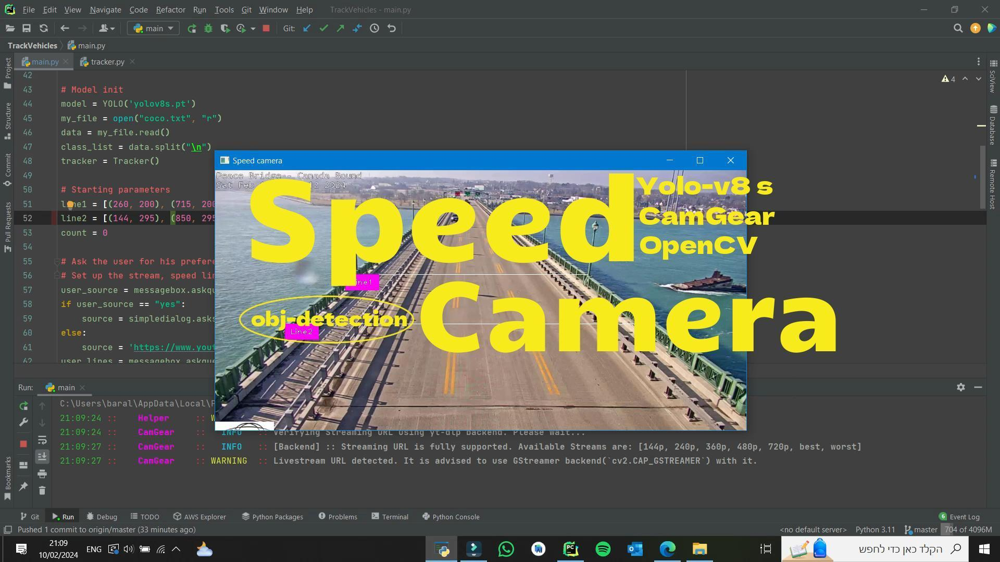
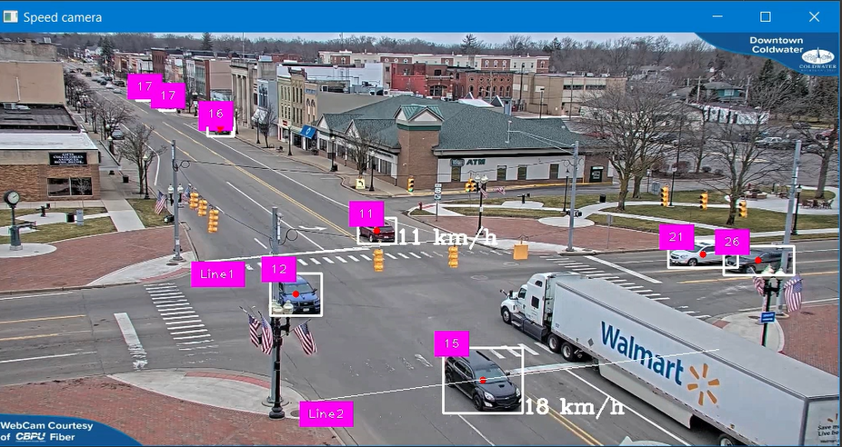

<div align="center">


**A speed camera built on YOLOv8 object detection and a custom tracker**


</div>

<br/>

<p align="center">
  
</p>

> [!NOTE]
> Point it at any video stream, draw your own speed lines, and it detects, tracks and measures the speed of every vehicle.

## ✨ Features

| | Feature | |
|:-:|---|---|
| 📹 | **Any video source** | Plug in your own stream URL (CamGear) |
| 📏 | **Your own speed lines** | Mark the lines used for speed measurement to fit any road |
| 🎯 | **Custom tracker** | Assigns and updates IDs per vehicle, matches them across frames and drops them when they leave |
| ⏱️ | **Live speed** | Speed from distance and time between lines, drawn on the video |

<p align="center">
  
</p>

## 🚀 Get started

1. Download YOLOv8 weights (e.g. `yolov8s.pt`) into the project folder.
2. Run:

```bash
python main.py
```

3. Follow the prompts to set the video source and draw the speed lines.

## 🗂️ Structure

| File | Role |
|---|---|
| [`main.py`](main.py) | Runs the pipeline: setup, detection, tracking and display |
| [`setup.py`](setup.py) | Prompts for the video URL and the speed lines |
| [`tracker.py`](tracker.py) | Vehicle tracking and ID management |
| [`speed_check.py`](speed_check.py) | `SpeedCheck` class: speed from line crossings |
| [`draw.py`](draw.py) | Drawing lines and labels on frames |
| [`coco.txt`](coco.txt) | COCO class names |

## 🙏 Built with

[YOLOv8](https://github.com/ultralytics/ultralytics) (Ultralytics) · [CamGear](https://github.com/abhiTronix/vidgear) (VidGear) · [OpenCV](https://opencv.org/) · [cvzone](https://github.com/cvzone/cvzone)


